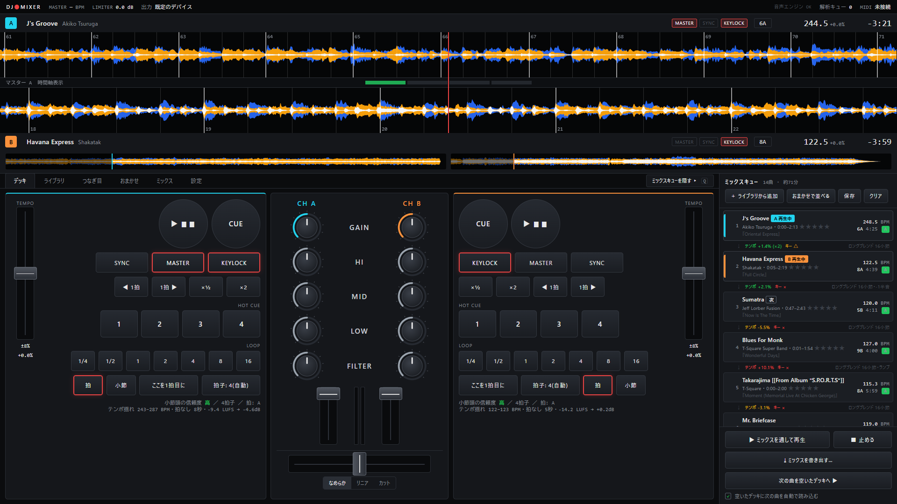
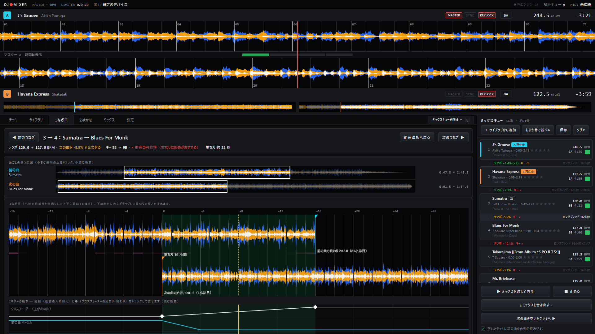
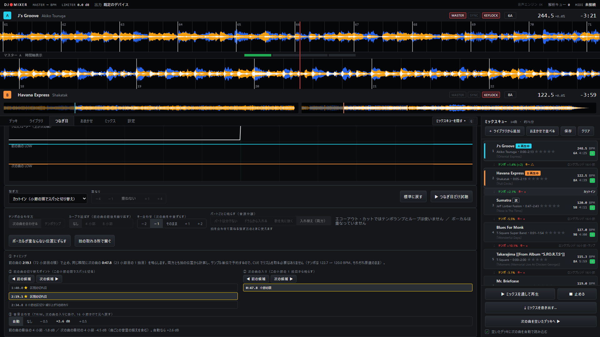
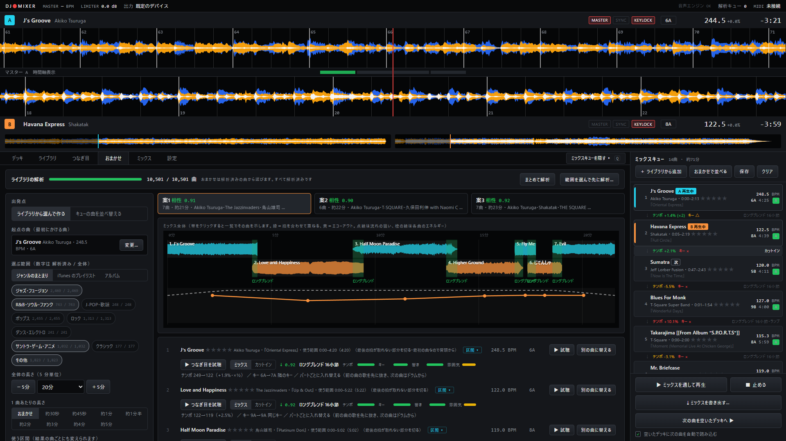
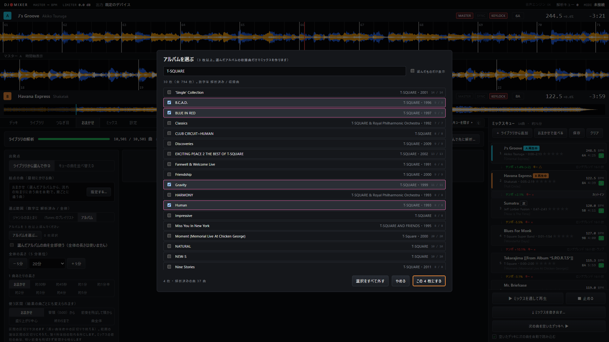

# DJ Mixer

手元の音楽ファイル（音楽フォルダは設定で複数指定できます）を、DJ のように 2 台のデッキで繋いで楽しむための Windows 用アプリです。
ジャズ・フュージョンのように**テンポが揺れる曲どうしでも拍を合わせられる**ことを重視しています。

企画の経緯・打合せ・検証結果は [report.md](report.md)、設計は [design_phase1.md](design_phase1.md)・[design_phase2.md](design_phase2.md)・[design_phase3.md](design_phase3.md)・[design_phase4.md](design_phase4.md) にあります。

## 画面

**デッキとミキサー** — 2 台のデッキ（上は拍に合わせて拡大した波形、小節番号つき）、3 バンドの EQ・フィルター・クロスフェーダー、右はミックスキュー（曲間の相性と繋ぎ方）



**つなぎ目エディタ** — 2 曲を小節の目盛りをそろえて重ね、重なりの長さ・低音の入れ替え・クロスフェードを決める（下はミキサーの自動の動き。ドラッグで直せる）



**カットイン** — 前の曲の小節の頭でスパッと次の曲の 1 拍目へ。切り替えポイントの候補（★ がおすすめ）と、入りの音量合わせ（TRIM）



**おまかせ** — 起点の曲・選ぶ範囲・長さ・流れから、相性の良い並びを 3 案。タイムラインで重なりとエネルギーの流れが見える



**アルバムで選ぶ** — 3 枚以上のアルバムを選び、その収録曲だけでミックスを作る



そのほかの画面:

| 画面 | 内容 |
|---|---|
| [ライブラリ](docs/screenshots/library.png) | 曲の一覧（BPM・キー・音量・★・再生回数）、フォルダ／アーティスト／アルバム／プレイリストで絞り込み |
| [曲ごとの使う範囲](docs/screenshots/joins-range.png) | 波形とパート（歌・ドラム・ベース・その他）の帯、区間の候補から使う範囲を選ぶ |
| [ミックス](docs/screenshots/mixes.png) | 作ったミックスの一覧・曲目・書き出したファイル |
| [書き出し](docs/screenshots/export.png) | 高速で書き出す／再生しながら録音する、WAV・MP3、曲目リスト |
| [設定](docs/screenshots/settings.png) | 出力・音量・テンポ、音楽フォルダ、iTunes との連携、MIDI コントローラー、キーボード |

スクリーンショットは `tools\screenshots.py` で撮り直せます（データの複製でアプリを起動し、画面のないブラウザで音を出さずに撮影します）。

## はじめての方へ（インストール）

Windows 11 の PC で使えます。NVIDIA の GPU があると曲の解析が速くなります（無くても動きます）。

1. **このアプリを手に入れる**（GitHub のアカウントは要りません）
   - [このページ](https://github.com/Mitsuhide6319/DJ-Mixer)の緑の「**Code**」→「**Download ZIP**」でダウンロードし、好きな場所に展開します（例: `C:\Apps\DJ-Mixer`。パスに日本語が入らない所がおすすめ）
   - git を使える方は `git clone` でも構いません（更新は `git pull`）
2. **`setup.bat` をダブルクリック**
   - 足りない道具（uv・ffmpeg）を winget で入れ、Python 3.11 と必要な部品をこのフォルダに入れ、デスクトップに「DJ Mixer」のショートカットを作ります
   - 初回は約 3GB のダウンロードがあります（回線によって 10〜30 分）。途中で winget の同意を求められたら Y を押してください
   - 何度実行しても大丈夫です。うまくいかなかったときは、もう一度実行してください
3. **デスクトップの「DJ Mixer」から起動**
   - はじめての起動では「音楽フォルダを選んでください」と出ます。曲が入っているフォルダを選ぶと、曲を読み込みます
   - **おまかせ**タブの「ライブラリの解析」→「**まとめて解析**」で曲を解析します（拍・テンポ・キーなど。1 万曲で数時間、GPU が無いともっとかかります）。
     解析中もアプリは使えます。デッキで鳴らす曲は、読み込んだときにその場で解析します
   - 拍の検出と音源分離の学習済みモデルは、初めて使うときに自動でダウンロードされます

**更新するとき**: ZIP で入れた場合は、新しい ZIP を同じフォルダに上書きで展開してから、もう一度 `setup.bat` を実行します（ライブラリ・解析結果・作ったミックスは `data` フォルダにあり、消えません）。

**曲とミックスについて**: 曲のファイルと、このアプリで作ったミックスは、個人で楽しむ範囲（自宅で流すなど）でお使いください。ファイルを人に渡したり公開したりはしないでください。

## 起動（開発する人向け）

```
run.bat
```

専用ウィンドウが開きます（コンソールの窓は出ません。デスクトップの「DJ Mixer」ショートカット・`DJ Mixer.vbs` のダブルクリックでも同じ。ショートカットは `tools\make_shortcut.ps1` で作り直せます）。初回はライブラリの読み込みに 2 分ほどかかります（2 回目以降は 1 秒以内）。
開発時にブラウザで開くときは `run.bat --browser`、サーバーだけ起動するときは `run.bat --server --port 8766`。

必要なもの: [uv](https://docs.astral.sh/uv/)、ffmpeg（PATH が通っていること）、WebView2 ランタイム（Windows 11 は標準で入っています）、
NVIDIA GPU（無くても動きますが、曲の解析が遅くなります）。`setup.bat` はこれらを入れて `uv sync` とショートカットの作成まで行います。
音楽フォルダは設定タブで指定します（環境変数 `DJMIX_MUSIC_ROOT` で既定を決めることもできます）。

## 使い方

1. **ライブラリ**タブで曲を探し、「A」「B」でデッキに読み込むか、「＋キュー」でミックスキューに入れます。
   キューに入れた曲・デッキに読み込んだ曲は自動で解析されます（1 曲 4〜10 秒。全曲の一括解析はしません）。
2. 片方のデッキを再生し、もう片方で **SYNC** を押して再生すると、拍が合った状態で鳴ります。
   位相は数秒かけて自然に寄せます（◀1拍 / 1拍▶ ですぐにずらせます）。
3. **LOW** のつまみでベース（低音）を入れ替え、クロスフェーダーで繋ぎます。
4. ミックスキューの「次の曲を空いたデッキへ」で次の曲を読み込みます。
   「空いたデッキに次の曲を自動で読み込む」が ON なら、曲が終わったデッキに自動で読み込みます。

### 曲の使う部分を選んで、自動で繋ぐ（Phase 2）

1. ミックスキューに曲を入れ、**つなぎ目**タブを開きます（キューの曲をダブルクリックしても開きます）。
2. 波形の上をドラッグして、その曲の**使う範囲**を選びます。両端の取っ手で調整でき、端は小節の頭に吸着します
   （拍・自由にも切り替え可）。下に並ぶ**区間の候補**（静か・盛り上がり など）をクリックすると、その区間を選べます（Shift＋クリックで広げる）。
3. 下のつなぎカードで**重ねる長さ**（8/16/32 小節）を選び、「▶ つなぎ目だけ試聴」で実際に繋いだ音を確かめます。
4. もっと細かく直すときは「**細かく直す**」（またはキューの曲間の ↓ をクリック）で**つなぎ目エディタ**を開きます。
   - 2 曲の波形が小節をそろえて上下に並びます。下の曲を左右にドラッグすると重なりの長さが変わります。
   - **繋ぎ方**: ロングブレンド・ショート・低音だけ入れ替え・フィルター・エコーアウト・カットイン。
   - 下の「ミキサーの動き」の縦線（低音を入れ替える位置）と ◆（クロスフェードの始まり・終わり）をドラッグして直せます。線どおりに鳴ります。
   - テンポが離れすぎている（±30% 超）・拍が取れない部分を繋ぐときは、自動で「エコーアウト」に切り替わり、理由が表示されます。
5. キューの下の「**▶ ミックスを通して再生**」で、キューの曲が使う範囲どおりに順に流れ、つなぎ目で自動的に繋がります。
   「■ 止める」か Esc で止まります。
   - 繋いだ後、次の曲の速度は 8 小節かけて原速へ戻ります（設定タブ「繋ぎの後の速度」で OFF にできます）。
   - 繋ぎの途中でクロスフェーダーや LOW を動かすと、その操作子だけ手動になります（その繋ぎの間は自動で動かしません）。

使う範囲・つなぎの設定はキューと一緒に保存されます。

### おまかせで並べる・組み合わせの提案・書き出し（Phase 3）

1. **おまかせ**タブ（キューの「おまかせで並べる」でも開きます）の上部の「**ライブラリの解析**」で、曲を解析しておきます。
   おまかせは**解析済みの曲だけ**から選びます。
   - 「まとめて解析」で全曲を裏で解析します（1 万曲で約 2〜3 時間。自動では始まりません）。「範囲を選んで先に解析…」でジャンルのまとまり（ジャズ・フュージョン など）を先に解析できます
   - 再生中は控えめに進めます。「一時停止」で止め、アプリを閉じても次は「続きから」
2. 条件を選んで「**おまかせで作る**」:
   - 出発点: **ライブラリから選んで作る**（起点の曲・選ぶ範囲・全体の長さ（5 分単位）・1 曲あたりの長さ・使う区間（頭から／盛り上がり中心／終わりまで／曲全体））か、**キューの曲を並べ替える**（曲は変えずに並び・使う範囲・繋ぎ方を決める）
   - 流れ: 上げていく／キープ／山を作る／落ち着かせる／**自分で描く…**（盛り上がりの線を描く）
3. 3 つの案がタイムライン（曲の帯・重なり・エネルギーの流れ）と、曲ごと・つなぎごとの理由つきで出ます。
   「▶ 試聴」「▶ つなぎ目を試聴」で確かめ、気に入らない曲は「**別の曲に替える**」（前後の曲との相性の良い候補から選ぶ）。
4. 「**この案をキューに入れる**」→ つなぎ目タブ（Phase 2）で直せます。「▶ ミックスを通して再生」で聴けます。
5. ライブラリの解析済みの曲の「**合う曲**」で、その曲の次に合う曲を理由つきで探し、キューに足せます。
   候補はジャンル（まとまり）とアーティストで絞り込めます（アーティストは名前を入れて Enter、いくつでも）。
   ミックスキューの曲にマウスを乗せたときの「合う曲」でも探せます（選んだ曲はその曲のすぐ後ろに入ります。後ろに曲があれば前後の両方に合う曲）。
6. キューの下の「**⤓ ミックスを書き出す…**」:
   - **高速で書き出す**: 再生せずに計算します（40 分のミックスで約 1〜2 分）。繋ぎは自動の動きどおり。手で動かした操作は入りません
   - **再生しながら録音する**: 通し再生の音をそのまま録音します（ミックスの長さだけかかります）。手で動かした操作も入ります
   - 形式は WAV／MP3（320・192kbps）。曲目リスト（開始時刻つき）も書き出せます。既定の保存先は「ミュージック\DJ Mixer」

書き出したミックスは個人で楽しむ範囲でお使いください。

### ミックスの保存・好み・繋ぎ方の追加・歌の重なり（Phase 4）

- **ミックス**タブ: 作ったミックスの一覧（キューの「保存」、おまかせの「キューに入れる」、書き出しのたびに自動で残る）。
  選ぶと曲目と書き出したファイルが見え、「キューに開く」「▶ 通し再生」「⤓ 書き出す」「複製」「名前を変える」「削除」ができます。
- **★（評価）**: ライブラリの一覧・ミックスキュー・おまかせの結果・ミックスの曲目で、★ をクリックして 1〜5（同じ ★ をもう一度で消す）。
  ミックスタブの「好み」で、おまかせが「★ の多い曲を優先」「★1 は使わない」「最近 N 日にかけた曲は避ける」を使います。
  ライブラリの一覧に「最後にかけた日」（デッキで 30 秒以上・通し再生・書き出し）。
- **繋ぎ方の追加**（つなぎ目エディタの下の段。おまかせも自動で使います）:
  - テンポランプ: 重なりの間に前の曲のテンポを次の曲の元のテンポへ移す（テンポ差 6〜15% 向け）
  - ループで延ばす: 前の曲の最後の 4 か 8 小節を繰り返して長く重ねる
  - キー合わせ: 次の曲を半音ずらす（曲の終わりまで。相性の良くなるずらし方を示します）
- **歌の重なり**: 使う曲はパート（ボーカル・ドラム・ベース・その他）を自動で分析します（音源分離。1 曲 4〜9 秒）。
  範囲選択の波形の下にパートの帯、つなぎ目エディタで両方の曲に歌がある小節が赤。「ボーカルが重ならない位置にずらす」で重なりの長さと位置を直します。
  おまかせも歌もの同士のつなぎで自動で寄せます。まとめて解析では「範囲を選んで先に解析…」の「パートの分析も行う」で一緒に分析できます（時間は約 3〜4 倍）。
- **ライブラリの並べ替え**: 一覧の列の見出し（曲名・アーティスト・アルバム・長さ・BPM・キー・★・最後にかけた日）をクリックで昇順、もう一度で降順（▲▼）。
  値の無い曲は常に最後。選んだ並びは次に開いたときも同じです。
- **列の幅**: 見出しの右端（青く光る所）をドラッグで変えられます（ダブルクリックで元の幅）。並べ方・列の幅はアプリを閉じても残ります。
- **アーティスト・アルバムで絞り込み**: 左の「フォルダ／アーティスト／アルバム」を切り替えて選ぶか、一覧のアーティスト名・アルバム名をクリック。
  アーティストを選んでからアルバムに切り替えると、その人のアルバムだけが出ます。一覧の上に今の条件が出て、✕ で外せます（「すべての曲」で全部外れます）。
- **キューのクリア**: キューの「クリア」で、確かめてから空にします（「ミックスとして保存してからクリア」も選べます。通し再生中なら止めます）。
- **音楽フォルダを複数に**: 設定タブの「音楽フォルダ」で、パスを入力するか「フォルダを選ぶ…」で追加、「外す」で外します。
  外したフォルダの曲はライブラリ・おまかせ・まとめて解析に出なくなるだけで消えません（★・履歴・解析結果は残り、「戻す」で元どおり）。
  外付けドライブが外れているときは、そのフォルダを飛ばします（曲は消しません）。フォルダが 2 つ以上なら、ライブラリの左の一覧は音楽フォルダごとにまとまります。
- **iTunes の情報の取り込み**（設定タブ「iTunes との連携」）: iTunes の ★・再生回数・最後に再生した日・プレイリストを**読むだけ**で取り込みます（iTunes 側も、音楽ファイルのタグも変えません）。
  前提: iTunes → 編集 → 環境設定 → 詳細 →「iTunes ライブラリ XML をほかのアプリケーションと共有」。起動時と 5 分ごとに XML の更新を見て読み直します。
  - ★: アプリで付けた ★ を優先し、付けていない曲は iTunes の ★（**ピンク**で表示）。アプリの ★ を消すと iTunes の ★ に戻ります
  - ライブラリ: 左の一覧の「プレイリスト」（iTunes のフォルダの形のまま、⚙ はスマートプレイリスト）。選ぶとプレイリストの順（# 列）に並び、「この N 曲をキューに入れる」。列に「再生回数」
  - おまかせ: 「選ぶ範囲」を「iTunes のプレイリスト」に切り替えて、複数のプレイリストから選べます
  - 好み（ミックスタブ）: 「よく聴く曲を少し優先する」（アプリ＋iTunes の再生回数）。「最近かけた曲は避ける」は iTunes での再生も数えます
- **パートごとに鳴らす**（つなぎ目エディタ「パートごとに鳴らす（音源分離）」）: ドラムから入れる／歌を先に抜く／入れ替え（両方）。
  ロング・ショート・低音だけ入れ替えの繋ぎで使えます。使う曲は 1 曲 20 秒ほどで分離して保存します（5 分の曲で約 20MB）。
  おまかせはロングブレンドで「入れ替え」、歌が重なるショートで「歌を先に抜く」を自動で選びます（ミックスタブの好みで切れます）。
- **拍の取れる所で繋ぐ**: 曲の終わりがフェードアウトなどで拍が取れず、エコーアウトに切り替わる繋ぎは、つなぎ目エディタの「拍の取れる所で繋ぐ」で
  前の曲の終わり・次の曲の始まりをずらして、拍を合わせて繋げます。おまかせは最初からそうします。

- **カットイン**（design_cutin.md）: 重ねずに、前の曲の小節の頭でスパッと次の曲の 1 拍目へ切り替えます。拍を合わせないので、テンポの違う曲どうしでも繋げます。
  切り替えの時刻は拍の位置から計算して予約するので、ぴったり小節の頭で切り替わります（高速書き出しも同じ）。つなぎ目エディタで繋ぎ方を「カットイン」にすると:
  - 前の曲の**切り替えポイント**・次の曲の**入り**の候補（区間の切れ目・8 小節の区切り・サビの終わり／サビ頭の候補・歌の切れ目。★ がおすすめ）が並び、選ぶとそこで切り替わります。「◀ ▶」で前後の候補へ
  - **音量合わせ（TRIM）**: 自動（前の曲の最後の 4 小節と次の曲の最初の 4 小節の大きさをそろえる。±6dB まで）／なし／±0.5dB で手動。次の曲の 16 小節かけて元の音量へ戻します
- **アルバムで選ぶ**: おまかせの「選ぶ範囲」を「アルバム」にして「アルバムを選ぶ…」から 3 枚以上選ぶと、その収録曲だけでミックスの案を作ります（検索はアルバム名・アーティスト。数字は 解析済み / 収録曲）。
  - どのアルバムからも最低 1 曲入り、同じアルバムが続きにくくなります。案の見出しに「アルバムごと 3・1・4・2 曲」のように配分が出ます
  - 起点の曲はおまかせ（流れの始まりに合う曲を自動で。案ごとに違う曲）か、「指定する…」で選んだアルバムの曲から指定
  - 「選んだアルバムの曲を全部使う」で、全曲を並べ替えて繋ぎます（全体の長さは使いません）。全曲でも長さに届かないときは、作れる長さを知らせます
  - アルバムで選ぶときは、テンポで曲を外しません（合わない所はエコーアウトかカットインで繋ぎます）。「最近かけた曲は避ける」も使いません
  - アルバムはアルバム名で区別します（同じ名前の別のアルバムは 1 枚として扱われます）
- **短くたくさん繋ぐ**: おまかせの「1 曲あたりの長さ」で 約30秒／約45秒／約1分／約1分半 を選ぶと、各曲の盛り上がりの所を短く使って、たくさんの曲を繋ぎます（30 分で 45 秒なら約 50 曲）。
  重なりは曲の長さに合わせて短く（4〜8 小節）、ループでは延ばしません。カットインと組み合わせると、テンポの違う曲もテンポよく切り替えられます。
- **おまかせのつなぎ方**: 条件の「つなぎ方」で、おまかせ（重ねられない所は切れ目の良い小節でカットイン）／すべてミックス／すべてカットイン（テンポの離れた曲も候補に）。
  結果のつなぎ目ごとの「ミックス｜カットイン」でも切り替えられます（同じ並びのまま、その繋ぎを計算し直します）。

- **おまかせの結果の「区間 ▾」**: 曲ごとに使う区間（おまかせ・冒頭（0:00）から・前奏を飛ばして頭から・盛り上がり中心・終わりまで・曲全体（0:00〜最後）・自分で選ぶ…）を選び直すと、同じ並びで繋ぎを計算し直します。「自分で選ぶ…」は波形の上をドラッグして区間を決めます。ミックスの最初の曲は冒頭（0:00）から鳴らします。

### 小節の頭がずれているとき（ジャズでよくあります）

- 小節の頭にしたい拍の位置で「**ここを1拍目に**」。その拍を含む区間（拍が途切れるまで）が直ります。
- 「**拍子**」ボタンのメニューで、拍子（3〜7）、グリッドの前後のずらし、BPM 表示の ×½ / ×2 を変えられます。
- 修正は曲ごとに保存され、曲を解析し直しても消えません。

### キーボード

| キー | デッキ A | デッキ B |
|---|---|---|
| 再生 / 一時停止 | Z | M |
| CUE | X | , |
| SYNC | C | . |
| ナッジ −/+（押している間） | A / S | K / L |
| ホットキュー 1〜4 | 1〜4 | 7〜0 |

← / → でクロスフェーダー（Shift で大きく）、Q でミックスキューの表示切替。
ホットキューは Shift＋クリックか右クリックで削除します。

### DJ コントローラー（MIDI）

操作子（ボタン・つまみ・フェーダー）を**右クリック →「MIDI 割り当て」**を選び、コントローラーの操作子を動かすと割り当てられます。
ボタン・フェーダー・ノブ・回し続けるエンコーダー（相対値）・ピッチベンドを自動で見分けます。
つまみの位置が画面の値に追いつくまでは反映しない（ソフトテイクオーバー）ので、値が急に飛びません。
割り当ては `config/mappings/default.json` に保存され、設定タブで確認・種類の変更・削除ができます。

## 開発

```
uv run pytest                 # サーバー・解析のテスト（G:\MUSIC があれば実曲のテストも実行）
```

- ブラウザ単体テスト: サーバー起動中に `http://127.0.0.1:<port>/tests/test.html` を開く（ミキサーの周波数特性・MIDI の判定など）
- 同期の精度試験: 2 曲を SYNC 状態で再生し、画面の開発者コンソールで
  `const t = await import('/tests/sync-e2e.js'); t.start();` → 数分後 `await t.stop()`。
  繋ぎを試すときは `t.start('pre')`（EQ の前から録音）、ミックス全体の録音は `t.recheck(1, [[開始秒, 終了秒], …])` で重なりの区間だけを比べる
- ログ: `data/djmix.log`（画面側のエラーもここに記録されます）

### 構成

| 場所 | 内容 |
|---|---|
| `djmix/` | バックエンド（FastAPI）。ライブラリ走査・解析（Beat This! / librosa）・PCM 配信・MIDI・設定 |
| `djmix/planner/` | おまかせ: 要約（track_desc）・ジャンルのまとまり・相性の行列と並びの探索 |
| `djmix/export/` | 書き出し: 録音の保存・高速書き出し（再生と同じ規則で計算するミキサー） |
| `djmix/mixes.py`・`prefs.py` | ミックス（保存したキュー）・★・再生の履歴 |
| `djmix/analysis/stems.py` | 音源分離（Demucs）で小節ごとのパートの量 |
| `frontend/` | 画面と再生エンジン（Web Audio。ビルド不要の ES Modules） |
| `frontend/vendor/signalsmith-stretch/` | テンポ変更ライブラリ（MIT）。**ローカルで不具合を修正済み**（`SOURCE.md` を参照。更新時は修正を当て直すこと） |
| `data/` | ライブラリの DB・解析キャッシュ・ログ（再生成できる） |
| `config/mappings/` | コントローラーの割り当て |
| `phase0/`、`mockup/` | 企画段階の検証スクリプトと画面モックアップ |

## 既知の制約

- 出力は 1 系統（ヘッドホンでの事前試聴はしません）。出力デバイス名は、ブラウザの仕様で「出力デバイス 1」のように表示されます。
- 1 曲に 1 つの拍子を割り当てます（Money のように途中で拍子が変わる曲は、拍子と「ここを1拍目に」で区間ごとに直してください）。
- 拍の検出器は、拍がまばらなイントロなどで半拍ずれて拾うことがあります。その区間だけ、同期の精度試験の値が悪く出ることがあります（前後の区間でずれが 0 に戻っていれば検出器の誤りです）。
- おまかせの「相性」は、テンポ（倍/半を考慮）・キー・繋ぐ部分の響き・拍を合わせられるか・音の雰囲気（明るさ・低音の割合・音の密度）で計算します。曲名やジャンルの意味（「バラード」など）までは見ていません。
- 高速書き出しのリミッターは、再生のリミッター（ブラウザの圧縮）に近い動きを Python で作り直したものです。音量は再生の録音と ±0.1dB でそろいますが、波形がサンプル単位まで同じにはなりません。
- 高速書き出しは、チャンネルフェーダー全開・GAIN 0dB として計算します（再生中に動かした値は使いません）。
- 音源分離（Demucs htdemucs）の学習済みモデルは、初めて使うときに自動で取得されます（約 80MB）。GPU が無いと 1 曲 1 分ほどかかります。

## ライセンス

このアプリは MIT ライセンスです（[LICENSE](LICENSE)、Copyright (c) 2026 Mitsuhide6319）。

### 使っている部品

| 部品 | 用途 | ライセンス | 入れ方 |
|---|---|---|---|
| Signalsmith Stretch（Web 版 1.3.2） | テンポ・音程の変更 | MIT | 同梱（`frontend/vendor/signalsmith-stretch/`、本文は `LICENSE.txt`。ローカルで修正あり） |
| Beat This! | 拍・小節頭の検出（コード・学習済みの重み） | MIT | `uv` で導入。重みは初回に自動で取得 |
| Demucs（htdemucs） | パートの分離 | MIT（コード）。学習済みの重みのライセンスは公式に明記が見当たらない | `uv` で導入。重みは初回に自動で取得 |
| PyTorch・numpy・scipy・librosa・soundfile・numba・uvicorn・pywebview・python-stretch・python-rtmidi・FastAPI・pyloudnorm・matplotlib | 計算・音声・画面・サーバー | BSD・ISC・MIT・PSF 系 | `uv` で導入 |
| mutagen | 曲のタグの読み取り | GPL-2.0 以上 | `uv` で導入（このリポジトリには含めない） |
| ffmpeg | 音声の読み込み・MP3 への書き出し | 入手した版による（LGPL／GPL） | 各自で導入（このリポジトリには含めない） |

依存する部品はリポジトリに含めず、各自の環境に `uv` で入れる形です。exe などにまとめて配る場合は、mutagen（GPL）と ffmpeg のライセンスの条件（ソースの提供・表示）が掛かります。

### 曲と書き出したミックスについて

曲のファイルと、このアプリで作ったミックス（録音・書き出し）は、それぞれの曲の著作権の対象です。個人で楽しむ範囲（自宅で流すなど）で使い、ファイルを人に渡したり公開したりはしないでください。

